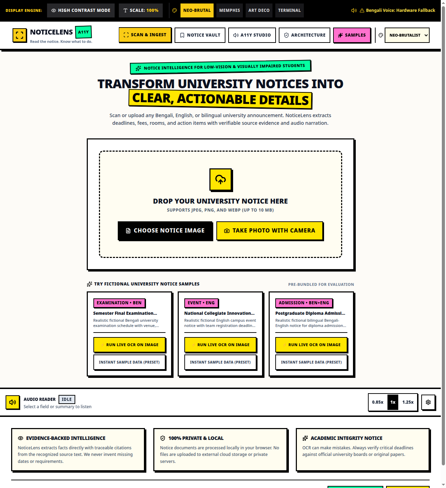
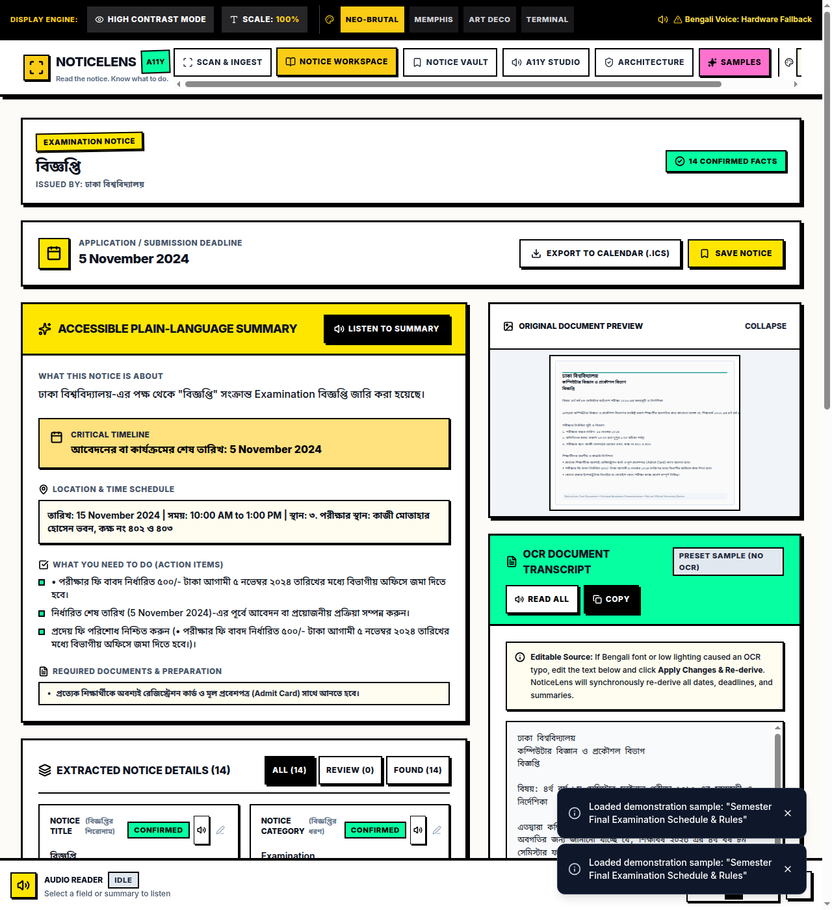
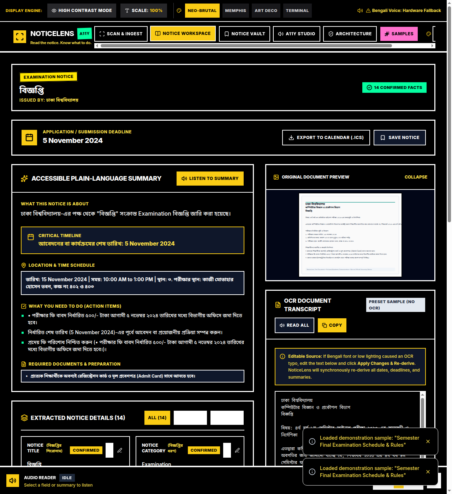

# NoticeLens

> **Read the notice. Know what to do.**

[](https://opensource.org/licenses/MIT)
[](https://www.typescriptlang.org/)
[](https://vitejs.dev/)
[](https://tailwindcss.com/)
[](https://www.w3.org/WAI/standards-guidelines/wcag/)
[](https://vitest.dev/)
[-sky.svg)](https://tailwindcss.com/)

**NoticeLens** is an AI-assisted accessibility and document intelligence web application designed for university students with visual impairments or low vision in Bangladesh. It transforms printed and photographed Bengali, English, and mixed-language university notices into an accessible, structured, verifiable, and actionable workspace.

---

## Visual Showcase


*Figure 1: NoticeLens Scan & Ingest interface with accessible upload dropzone, contrast enhancement toggle, and evaluation samples.*


*Figure 2: NoticeLens Workspace showing accessible plain-language summary, deadline calendar action, traceable OCR transcript, and extracted facts.*


*Figure 3: Dedicated High-Contrast Mode engineered for low-vision readability with deep-black background and solid high-contrast borders.*

---

## The Problem
University notices in Bangladesh are frequently published as low-resolution photos or physical flyers pinned to departmental notice boards. They feature:
- Complex Bengali and English typography.
- High-stakes examination dates, room schedules, and seat allocations.
- Crucial application deadlines, admission portals, and payment receipts.
- Dense administrative paragraphs where actionable information is difficult to find.

Conventional OCR solutions dump unformatted text without explaining what the student needs to do, while cloud AI readers often hallucinate deadlines or compromise privacy by uploading sensitive student documents.

---

## Our Solution
NoticeLens provides **evidence-backed notice intelligence**:
1. **Bilingual OCR**: Recognizes Bengali, English, and mixed-language text directly in the browser via Tesseract.js using local worker and core assets that comply with strict Content Security Policy (CSP).
2. **Context-Aware Extraction**: Automatically isolates 14 structured fields (Deadline, Examination Date, Start/End Time, Venue, Required Documents, Fees, Actions, Contacts, Portal URLs) with strict calendar date validation that never invents missing years.
3. **Traceable Citations**: Every extracted fact retains an exact character pointer to its supporting snippet in the raw notice, highlighted on click via normalized index mapping.
4. **Accessible Plain-Language Summary**: Breaks circulars down into: *What it's about*, *Critical deadline*, *What you need to do*, *Where and when*, *Required documents*, and *Missing/unverified details*.
5. **Atomic Human-in-the-Loop Correction**: Edit the raw OCR transcript and NoticeLens synchronously re-derives all fields and summaries without stale-state race conditions. When a user manually corrects a field, the UI transparently marks it as a user override and preserves provenance.
6. **Honest Web Speech Audio Narration**: Integrated audio controls with voice discovery, adjustable speed, and transparent status when a host OS lacks a native Bengali voice engine.
7. **Private Local Persistence**: Saves notices privately in browser IndexedDB (`NoticeLensDB`) with durable base64 image persistence and zero cloud data transmission.
8. **Timezone-Aware Calendar Export**: Generates RFC 5545 `.ics` files with line folding, `Asia/Dhaka` timezone definitions (`VTIMEZONE`), and an explicit review gate for ambiguous dates.

---

## Key Differentiators
- **Verifiable Evidence**: We never output ungrounded assertions. Every date, room, and fee is visually linked to its source line in the document.
- **Strict Date Validation**: Rejects impossible calendar dates (such as 31 February or 31 April) and strictly validates leap years. Yearless dates require user review and are never silently assigned the current year.
- **Zero API Keys Required**: 100% of OCR, text processing, audio synthesis, and storage runs locally in your browser.
- **Accessibility by Architecture**: Built according to WCAG 2.2 AA standards with keyboard navigation, visible focus indicators, screen reader live regions, high-contrast mode, and text scaling.

---

## Architecture & Data Flow

```
[Uploaded Notice Image / Camera]
               │
               ▼
   [In-Memory Canvas Enhancement]  (Grayscale & Contrast Stretching)
               │
               ▼
       [Local Tesseract.js OCR]    (Worker-based bilingual recognition, CSP-safe)
               │
               ▼
    [Raw OCR Text Transcript]  ◄──►  [Atomic Transcript Editor & Synchronous Re-extraction]
               │
               ▼
      [Extraction Engine]
         ├── Numeral Normalizer     (০-৯ ↔ 0-9)
         ├── Strict Date Validator  (Leap years, month bounds, no invented years)
         ├── Contextual Classifier  (Deadlines vs Events vs Publications)
         ├── Time Window Parser     (Asia/Dhaka local time, 12-Hour AM/PM)
         └── Normalized Index Matcher (Exact character ranges in original text)
               │
               ▼
    [Structured Notice Model]
         ├── 14 Typed Fields with Review Status (Confirmed / Needs Review / User Edited)
         ├── Plain-Language Accessible Summary
         ├── Web Speech Audio Reader (Synthesis with Voice Discovery)
         ├── IndexedDB Local Database (Saved Notices & Base64 Data URLs)
         └── Calendar Review Gate & Exporter (RFC 5545 .ics with Asia/Dhaka TZID)
```

---

## Technology Stack
- **Frontend**: React 18, TypeScript (Strict Mode), Vite 5
- **Styling**: Tailwind CSS v3 with verified `.high-contrast` variant plugin, accessible type scales
- **OCR Engine**: Tesseract.js v7 (Self-hosted local worker `/tesseract/worker.min.js`, bilingual `ben+eng`, `ben`, `eng`)
- **Speech & Accessibility**: Web Speech API (`SpeechSynthesis`), ARIA Live Regions, WCAG 2.2 AA Focus Styles
- **Storage**: IndexedDB (`NoticeLensDB`) with `localStorage` fallback and base64 persistence
- **Export**: RFC 5545 iCalendar (`.ics`) with line folding and `Asia/Dhaka` timezone support
- **Icons**: Lucide React
- **Testing**: Vitest v2, React Testing Library, Happy-DOM (54 automated unit & integration tests)

---

## Prerequisites
- Node.js: `v18.0.0` or higher (tested on Node.js v18.19.1)
- npm: `v9.0.0` or higher
- Any modern web browser (Chrome, Edge, Firefox, Safari)

---

## Installation & Setup

```bash
# 1. Clone repository (or navigate to project directory)
cd noticelens

# 2. Install dependencies
npm install

# 3. Start local development server
npm run dev

# The app will be available at: http://localhost:5173
```

---

## Available Commands

| Command | Description |
| :--- | :--- |
| `npm run dev` | Starts Vite local development server with Hot Module Replacement (HMR) |
| `npm run build` | Compiles TypeScript (`tsc -b`) and builds optimized production bundle via Vite in `dist/` |
| `npm run test` | Executes all 54 automated Vitest unit and integration test suites |
| `npm run lint` | Runs ESLint checks across the TypeScript codebase |
| `npm run preview` | Serves the production build locally |

---

## OCR Setup & Language Data Behavior
NoticeLens uses Tesseract.js with local worker assets (`/tesseract/worker.min.js`, `tesseract-core-lstm.js`, `*.wasm`) placed in `/public/tesseract/` to satisfy strict Content Security Policy directives:
- When a notice is scanned, the local worker initializes from `'self'` without relying on external CDN worker blobs.
- On first execution for a language (e.g. `ben+eng`), Tesseract loads trained language data and caches it locally in IndexedDB for subsequent offline use.
- The OCR processing card streams real progress percentages (e.g. `20%`, `65%`, `95%`) with transparent loading states.
- If an image has poor lighting, enable **"Enhance contrast for printed notice readability"** to trigger canvas-level luminance normalization.

---

## Browser Speech Voice Behavior
NoticeLens inspects the host device's available voice catalog using `speechSynthesis.getVoices()`.
- If a native Bengali voice package (e.g. `bn-BD` or `bn-IN`) is detected, NoticeLens automatically utilizes it for Bengali text reading.
- If the operating system lacks an installed Bengali voice (common in minimal Linux distributions or default Windows setups), NoticeLens **honestly advises the user** via a dedicated toolbar warning and uses the closest available speech engine without crashing or pretending that native speech succeeded.

---

## Privacy & Data Protection
- **No External Uploads**: Documents and notice images are processed entirely in browser memory.
- **Local Private Storage**: Saved notices, titles, and extracted deadlines reside strictly in the browser's local IndexedDB (`NoticeLensDB`). Images are stored as durable base64 Data URLs so records survive browser restarts without broken `blob:` references.
- **Data Cleanup**: Clearing browser site data immediately removes all stored notices. An explicit "Delete Notice" dialog with focus trap allows students to erase items anytime.

---

## Quality Assurance & Test Verification
All 54 unit and integration tests run cleanly:
```bash
npm run test
```
Test coverage across 5 suites includes:
- **Atomic Transcript Re-extraction**: Editing a date or text in the transcript string re-derives fields from the updated text, replaces old dates, and updates summaries without race conditions.
- **Strict Calendar Date Validation**: Validates month lengths, leap years (2024 leap vs 2023 non-leap), and rejects impossible dates (e.g. 31 Feb, 30 Feb, 31 Apr).
- **Date Provenance**: Yearless dates are never silently assigned the current year; ambiguous dates require explicit review.
- **RFC 5545 iCalendar Compliance**: Validates line folding at 75 octets, `Asia/Dhaka` `VTIMEZONE` blocks, CRLF injection neutralization, and truthful attribution.
- **Evidence Index Mapping**: Exact character slice offsets in original transcript without index drift or overflow.
- **Sample Provenance**: Preset demo samples do not possess fabricated OCR confidence scores.

See [docs/TEST_REPORT.md](docs/TEST_REPORT.md) for full audit records.

---

## Hackathon Submission Documents
- [docs/DEVPOST.md](docs/DEVPOST.md) — Comprehensive Devpost submission draft
- [docs/DEMO_SCRIPT.md](docs/DEMO_SCRIPT.md) — 2 minute 30 second timed live demo script
- [docs/TEST_REPORT.md](docs/TEST_REPORT.md) — QA test execution and browser verification report
- [docs/screenshots/](docs/screenshots/) — Verified UI screenshots

---

## License
MIT License. Created for the Hackathon by the NoticeLens Engineering Team.
