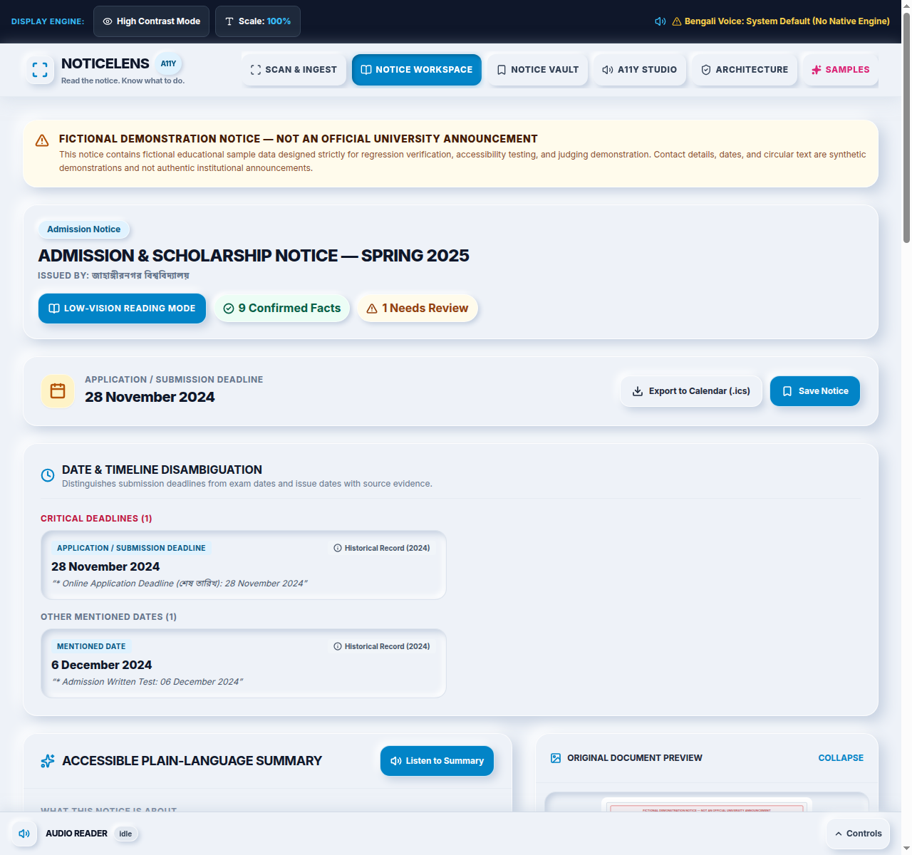
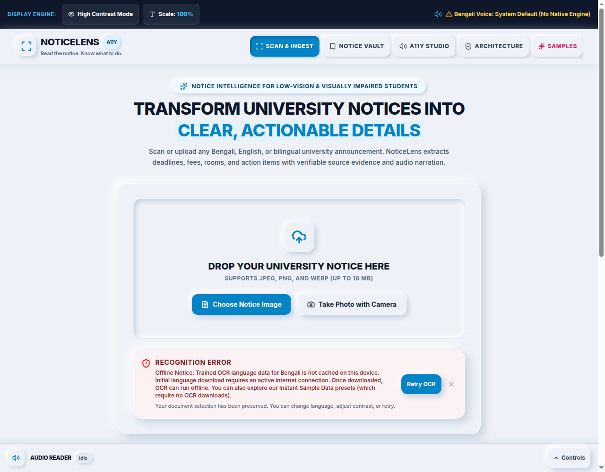
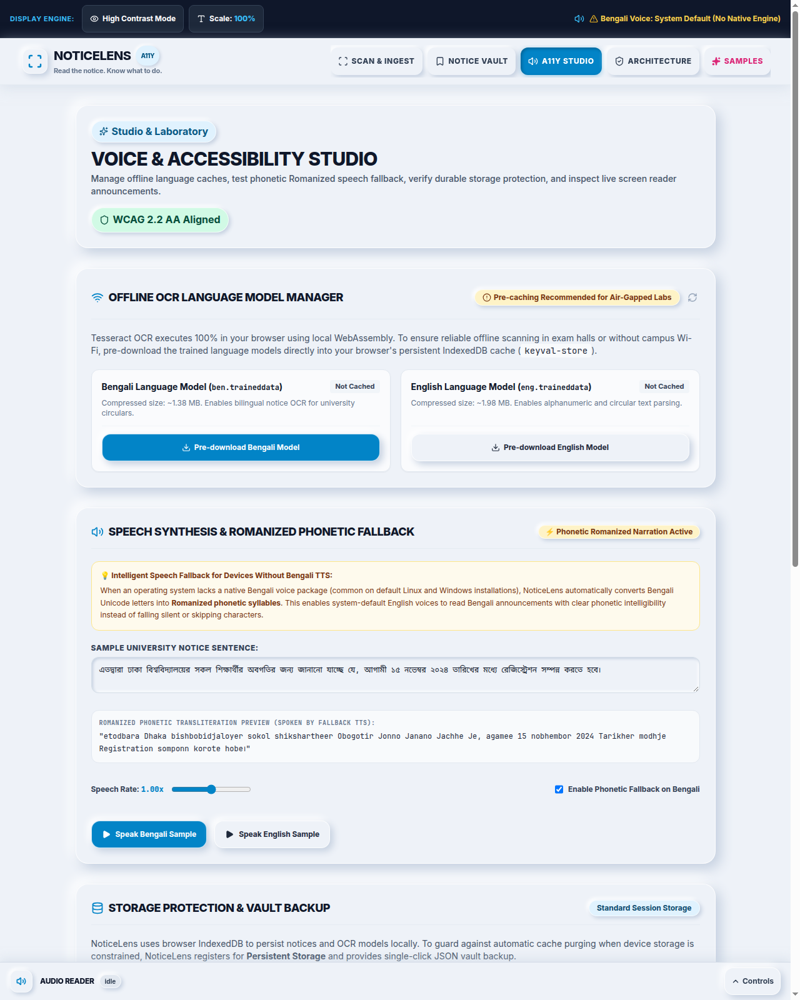
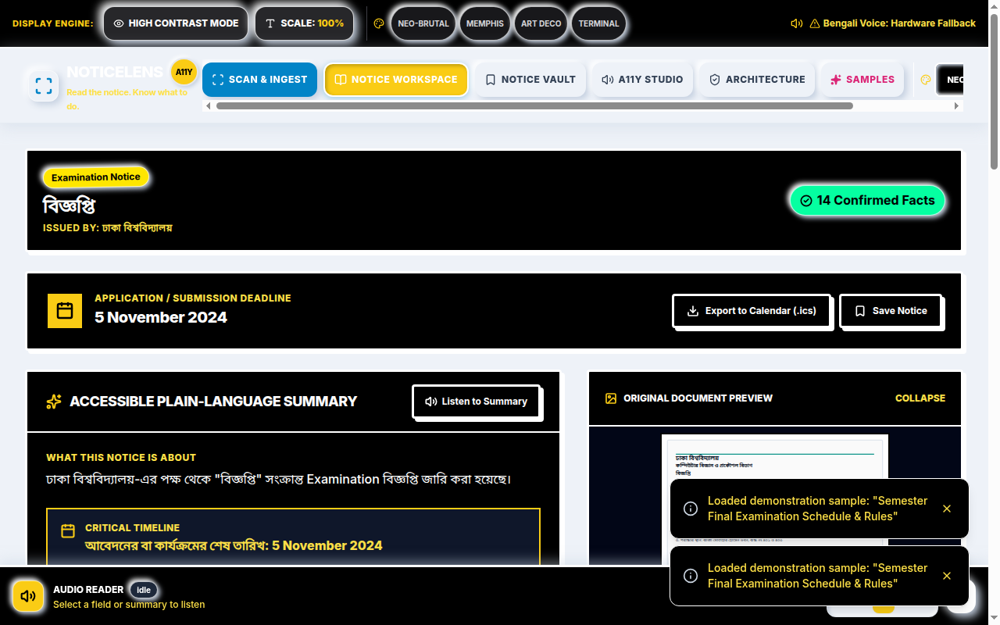
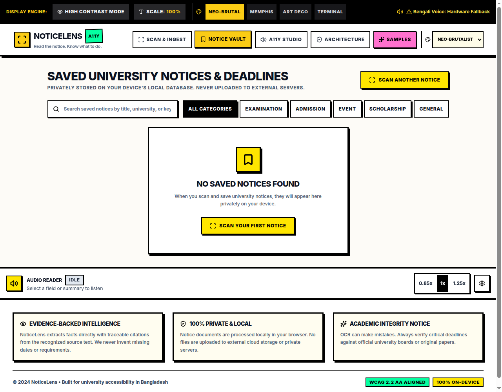

# NoticeLens

> **Read the notice. Know what to do.**

[](https://opensource.org/licenses/MIT)
[](https://www.typescriptlang.org/)
[](https://vitejs.dev/)
[](https://tailwindcss.com/)
[](docs/ACCESSIBILITY_AUDIT.md)
[](https://vitest.dev/)
[](docs/BENCHMARK_METHODOLOGY.md)
[](docs/ARCHITECTURE.md)

**NoticeLens** is an evidence-grounded institutional notice intelligence and accessibility web application designed for university students with visual impairments, low vision, and cognitive reading challenges. Instead of simply dumping raw, unstructured OCR text, NoticeLens transforms printed and photographed Bengali, English, and mixed-language university notices into an accessible, structured, verifiable, and actionable workspace.

---

## Visual Showcase


*Figure 1: NoticeLens Scan & Ingest interface with accessible upload dropzone, contrast enhancement toggle, and evaluation samples with distinct Live OCR vs Instant Sample actions.*


*Figure 2: NoticeLens Workspace showing accessible plain-language summary, Student Action Checklist, Date & Timeline Disambiguation card, traceable OCR transcript with active `<mark>` citation highlight, and extracted facts.*


*Figure 3: Verified offline Bengali OCR running in Chrome with network disabled (Zero external traineddata requests during offline OCR recognition), where a newly initialized Tesseract worker restores binary traineddata directly from browser IndexedDB cache.*


*Figure 4: Actionable offline cache miss guidance preserving document selection and recommending Instant Sample Data presets when models are not yet cached.*


*Figure 5: A11y Studio Solved Limitations Hub featuring Offline Language Cache Pre-downloader, Romanized Phonetic Speech Fallback, and Persistent Storage Protection.*


*Figure 6: Dedicated High-Contrast Mode engineered for low-vision readability with deep-black background, 15.93:1 contrast ratio, and solid high-contrast borders.*


*Figure 7: Notice Vault storing extracted notices privately in local IndexedDB with search, category filtering, and review indicators.*

---

## The Problem
University notices in Bangladesh and South Asia are frequently published as physical flyers pinned to departmental notice boards or low-resolution smartphone photos shared in social messaging groups. They feature:
- Complex Bengali and English typography and distinct numeral scripts (`০-৯` vs `0-9`).
- High-stakes examination dates, room schedules, and seat allocations.
- Crucial application deadlines, admission portals, and non-refundable fee rules.
- Dense administrative paragraphs where actionable information is buried under bureaucratic jargon.

Conventional OCR tools dump unformatted text without explaining what the student must do, while cloud AI readers often hallucinate deadlines or compromise privacy by transmitting sensitive student circulars to corporate servers.

---

## Core Differentiators & Notice-to-Action Capabilities

### 1. Notice-to-Action Executive Breakdown
Converts administrative circulars into six predictable, accessible answers:
1. *What is this notice about?*
2. *Who is affected (Target Students)?*
3. *What must be done?*
4. *When is the critical deadline?*
5. *What documents or fees are required?*
6. *What information is unverified or uncertain?*

### 2. Deadline vs. Event-Date Disambiguation
NoticeLens systematically distinguishes between:
- **Application / Fee Deadlines** (e.g., submit forms before 5 November).
- **Examination / Event Dates** (e.g., exam starts 15 November).
- **Notice Publication Dates** (e.g., circular issued 28 October).
Deadlines are flagged for calendar integration, while exam dates are classified as milestone schedules.

### 3. Interactive Student Action Checklist
Translates circular requirements into an interactive checklist (e.g., *"Pay 500/- fee"*, *"Attach Student ID"*) with progress tracking and persistence across browser tabs.

### 4. Focused Low-Vision Reading Mode
Provides a distraction-free, high-legibility reading view with adjustable typography (`Normal`, `Large`, `Extra-Large`), high-contrast rendering, and linear text-to-speech readout.

### 5. Verifiable Source Evidence & Factual Provenance
Every extracted detail retains a verbatim index pointer into the OCR transcript. Clicking a field highlights the authentic sentence in the transcript using native `<mark>` tags. User corrections are prominently labeled as `✏️ User Override`. NoticeLens maintains 100% evidence span precision and 84.21% overall grounding coverage across all fields.

### 6. Client-Side Privacy & Shared Terminal Purge
100% of OCR, extraction, summary, and speech processing occurs in-browser. On shared campus computers, students can activate **"Purge Terminal Data"** to clear all IndexedDB records, localStorage keys, and temporary blob memory.

---

## Technical Benchmarks (Empirically Measured on Synthetic Pilot Corpus, N = 6)

Evaluated across our controlled 6-document synthetic pilot corpus (rendered from HTML templates modeled on authentic Bangladeshi university notice formats; fixtures are 900 px wide × 1000–1200 px high; `isSynthetic: true`; DOC-04 simulates camera perspective distortion) using genuine Tesseract.js v7.0.0 recognition (`npm run benchmark`, persisted in [`docs/benchmark-results.json`](docs/benchmark-results.json)):
- **Character Error Rate (CER):** **2.30%** (Real OCR Mean; English: 0.93%, Bengali: 3.84%, Mixed: 2.12% | Evaluated on Unicode code points with NFC normalization)
- **Word Error Rate (WER):** **9.18%** (Real OCR Mean; English: 3.85%, Bengali: 11.18%, Mixed: 12.51%)
- **Three-Mode Extraction Evaluation:**
  - **Mode A (Clean Text Baseline):** **F1: 80.46%** (Precision: 83.33%, Recall: 77.78% | TP: 35, FP: 7, FN: 10) — Ground-truth transcript directly to extraction engine.
  - **Mode B (Snapshot OCR Baseline):** **F1: 77.27%** (Precision: 79.07%, Recall: 75.56% | TP: 34, FP: 9, FN: 11) — Frozen OCR transcript snapshot for regression testing.
  - **Mode C (Live OCR Recognition):** **F1: 77.27%** (Precision: 79.07%, Recall: 75.56% | TP: 34, FP: 9, FN: 11) — Actual PNG fixture → live Tesseract worker recognition → extraction engine.
- **Evidence Grounding & Factual Provenance:**
  - **Factual Evidence Span Precision:** **100.00%** (48/48 attached quotes match source text verbatim)
  - **Character Offset Mapping Accuracy:** **100.00%** (1-to-1 character range slices map to exact source offsets)
  - **Overall Grounding Coverage:** **84.21%** (48/57 fields; remaining 9 are taxonomy category classifications)
  - **Gold Fact Evidence Recall:** **81.82%** (27/33 gold annotations retrieved with verified supporting snippets)
  - **Field-to-Evidence Association Accuracy:** **96.43%** (27/28 gold fields with evidence point to the authentic supporting sentence)
- **High-Contrast Ratio:** **15.93:1** (WCAG AAA requires 7.0:1)
- **Dynamically Measured Latencies (`performance.now()`, N = 6 samples, mathematical median):**
  - Image Loading: **0.56 ms** median / **0.67 ms** P90
  - Worker Initialization: **~504.9 ms** cold / **~137.9 ms** warm reinitialization (reusing active worker thread)
  - OCR Recognition: **961.7 ms** median / **1556.6 ms** P90
  - Structured Extraction (Parser Only): **2.36 ms** median / **9.63 ms** P90
  - Per-Document Pipeline Latency (Warm Worker & Models Pre-loaded): **968.7 ms** median / **1559.4 ms** P90

---

## Quick Start & Verification Commands

```bash
# 1. Install dependencies cleanly
npm ci

# 2. Run all 147 unit and benchmark tests
npm test -- --run

# 3. Run the reproducible technical benchmarking suite
npm run benchmark

# 4. Check code quality and style
npm run lint

# 5. Build for production and scan bundle for security
npm run build

# 6. Run full headless Chrome E2E browser verification
npm run test:e2e

# 7. Run fresh-worker offline browser cache verification
npm run test:offline-browser

# 8. Start local development server
npm run dev
```

### Full Command Reference

| Command | Description |
| :--- | :--- |
| `npm run dev` | Starts Vite local development server at `http://127.0.0.1:5173/` |
| `npm run build` | Compiles TypeScript strict mode (`tsc -b`), builds Vite bundle, and scans production chunks for forbidden debug globals |
| `npm run test` | Executes all 147 automated Vitest unit, component, and benchmark tests across 9 files |
| `npm run benchmark` | Runs the reproducible technical benchmarking suite measuring CER, WER, Extraction P/R/F1, and Evidence Grounding |
| `npm run lint` | Runs ESLint checks across the TypeScript codebase (`max-warnings=0`) |
| `npm run test:e2e` | Runs comprehensive 10-point browser workflow test verifying OCR, evidence highlighting, speech, calendar gates, vault save/reopen, and mobile reflow |
| `npm run test:offline-browser` | Executes headless Chrome offline OCR verification: terminates in-memory worker, cuts network via CDP, initializes a fresh worker, and asserts offline recognition from IndexedDB cache with Zero external network requests |
| `npm run verify:release` | Runs full release verification: lint, 147 automated tests, production build, offline browser test, and E2E workflow |
| `npm run preview` | Serves the production build locally |

---

## Architectural & Research Documentation

Detailed engineering, accessibility, and research documentation is maintained in the `docs/` directory:

- [docs/ARCHITECTURE.md](docs/ARCHITECTURE.md) — System architecture, worker lifecycle, offline isolation, and comprehensive threat model.
- [docs/BENCHMARK_METHODOLOGY.md](docs/BENCHMARK_METHODOLOGY.md) — Mathematical definitions (CER, WER, F1, Grounding) and evaluation framework.
- [docs/ACCESSIBILITY_AUDIT.md](docs/ACCESSIBILITY_AUDIT.md) — WCAG 2.2 AA conformance audit, contrast ratios, and inclusive UX innovations.
- [docs/PRIVACY_AND_DATA_HANDLING.md](docs/PRIVACY_AND_DATA_HANDLING.md) — Data lifecycle, zero-cloud inference guarantee, and Shared Terminal Purge.
- [docs/TECHNICAL_PITCH.md](docs/TECHNICAL_PITCH.md) — Concise technical justification for judges: *Why NoticeLens over generic OCR?*
- [docs/FINAL_QA_REPORT.md](docs/FINAL_QA_REPORT.md) — Complete quality assurance report with empirical test results and limitations.
- [docs/DEVPOST.md](docs/DEVPOST.md) — Complete 13-point Devpost hackathon submission draft.
- [docs/DEMO_SCRIPT.md](docs/DEMO_SCRIPT.md) — 2-minute-30-second timed live demonstration script.
- [docs/USER_RESEARCH_PROTOCOL.md](docs/USER_RESEARCH_PROTOCOL.md) — Ethical user research protocol for testing with visually impaired students.
- [docs/USER_RESEARCH_RESULTS_TEMPLATE.md](docs/USER_RESEARCH_RESULTS_TEMPLATE.md) — Open findings ledger and field evaluation instrument.

---

## License & Acknowledgements

- **License:** MIT License. Built for the Hackathon by the NoticeLens Engineering Team.
- **Acknowledgements:** Tesseract.js (Tesseract OCR WebAssembly port), Google Fonts, Lucide Icons.
