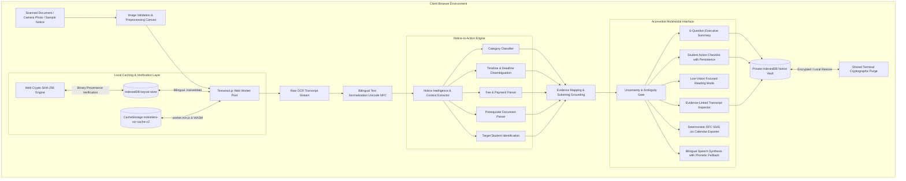

# NoticeLens — Technical Architecture & Security Specification
**Version:** 2.0.0 (Grand Final Submission Edition)  
**System Classification:** Evidence-Grounded Institutional Notice Intelligence & Accessibility Engine  
**Runtime Architecture:** Local-First, Browser-Native, Offline-Capable  

---

## 1. System Architecture Overview

NoticeLens is designed to transform complex, multi-lingual, visual university notices into structured, verified, accessible action items without transmitting user documents to external servers.

---

## 2. Core Subsystem Architectural Details

### 2.1 Worker Lifecycle & Offline Isolation
- **Dual-Phase Worker Architecture:** NoticeLens does not retain idle Web Workers in memory. Tesseract workers are spun up on-demand and terminated immediately upon completion of recognition (`worker.terminate()`), releasing heavy WASM heap memory.
- **Cache Hierarchy:**
  1. **Primary Binary Cache:** Trained language binaries (`ben.traineddata`, `eng.traineddata`) are stored as raw `ArrayBuffer` records in IndexedDB (`keyval-store`).
  2. **Core Engine Cache:** Tesseract worker scripts (`worker.min.js`) and relaxed-SIMD LSTM WASM binaries (`tesseract-core-relaxedsimd-lstm.wasm.js`) are cached via Service Worker `CacheStorage` under cache namespace `noticelens-ocr-cache-v2`.
- **Zero-Network Offline Guarantee:** When running offline, NoticeLens strictly intercepts worker initialization before any network dispatch. If trained language data is missing from IndexedDB, the pipeline halts with a helpful retry notice rather than attempting network access.

### 2.2 Binary Integrity & Cryptographic Provenance
To protect against corrupted, truncated, or malicious cache entries:
- **Structure Validation (`isValidTrainedDataBinary`):** Inspects the 16-byte Tesseract traineddata header (`TessdataManager` directory offset), verifies minimum payload size (> 50KB), checks directory entries count ($\ge 10$), and ensures the binary is not zero-filled.
- **Cryptographic Provenance:** Uses Web Crypto API (`crypto.subtle.digest('SHA-256')`) to calculate the exact SHA-256 fingerprint of the cached model. Offline verification records are keyed to the specific language and binary hash. If a cached model changes or fails hash validation, the record is immediately invalidated.

### 2.3 Evidence Grounding & Factual Provenance Architecture
NoticeLens separates itself from probabilistic LLMs through strict deterministic extraction:
- Every extracted field (`deadline`, `eventDate`, `venue`, `fees`, `requiredDocuments`, `contact`) maintains an `evidence` object containing the exact substring and index range from the OCR transcript.
- When an extracted fact is clicked, the UI renders a native `<mark>` highlight over the authentic transcript text.
- If a user manually edits the transcript, the engine automatically re-derives fields and purges any stale evidence pointers that no longer exist in the edited text.
- If a user manually edits a field value, NoticeLens visually marks the field as `✏️ User Override`, clearly distinguishing human input from machine extraction.

### 2.4 Multimodal Speech Synthesis & Phonetic Fallback
- **Primary Engine:** Web Speech API (`window.speechSynthesis`) configured with language auto-detection (`bn-BD` / `bn-IN` for Bengali text, `en-US` / `en-GB` for English text).
- **Phonetic Transliteration Fallback:** When running on devices or Linux configurations that lack a native Bengali speech synthesizer voice, NoticeLens invokes its deterministic Bengali-to-IPA/phonetic transliteration pipeline (`bengaliPhoneticFallback.ts`). This allows standard English TTS voices to speak phonetically approximate Bengali utterances, ensuring visually impaired users are never stranded without audio feedback.

---

## 3. Threat Model & Security Posture

NoticeLens operates under a comprehensive client-side threat model:

| Threat Category | Potential Attack Vector | NoticeLens Mitigation Mechanism | Residual Risk / Limitation |
| :--- | :--- | :--- | :--- |
| **Malicious File Upload** | Attacker uploads SVG/HTML with embedded `<script>` or zip bombs. | File type validation (`image/*`, strict MIME checking). Uploaded images are rendered through HTML5 Canvas / `ImageBitmap` pipelines that do not execute active scripts. | Extremely malformed TIFF/BMP could trigger browser canvas decode bugs; mitigated by file size ceiling (15MB). |
| **Cross-Site Scripting (XSS)** | Malicious notice text contains `<script>` or `onerror=` attributes rendered in transcript. | **Zero `dangerouslySetInnerHTML`:** All OCR transcripts and extracted values are rendered as pure React string child nodes. Highlighting is implemented via structured React component arrays (`<mark>{snippet}</mark>`). | None; string interpolation is escaped natively by React 18 virtual DOM. |
| **Cache Poisoning / Tampering** | LocalStorage or IndexedDB modified on shared machine to inject fake offline records. | Verification records require an exact SHA-256 match against the physical binary stored in IndexedDB. Fake hex hashes without matching binary data are immediately rejected. | Local attacker with full OS root access can modify browser storage; mitigated by session purge. |
| **Calendar Spoofing** | Notice contains historic dates or malformed syntax injected into `.ics` file. | RFC 5545 exporter validates calendar dates through strict ISO 8601 regex. Notices with missing years are blocked by a mandatory review modal gate (`MissingYearModal`). | User can explicitly enter an incorrect date in the review modal if they choose to do so. |
| **Public Terminal Exposure** | Next student on library PC views previous student's grades or notice history. | **Shared Terminal Purge:** One-click cryptographic purge removes all IndexedDB databases, localStorage keys, and revokes all active blob URLs (`URL.revokeObjectURL`). | Browser disk cache managed by the operating system is subject to browser process termination policies. |
| **Data Exfiltration** | University notices leaked to third-party AI cloud endpoints. | **Total Local-First Processing:** 100% of OCR, extraction, summary, speech, and calendar export executes in-browser. Zero outbound API calls for inference. | Initial download of Tesseract language traineddata requires trusted CDN / local hosting. |
